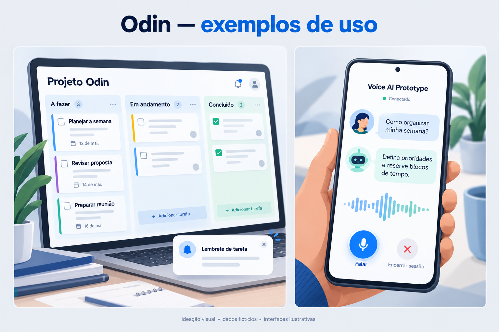
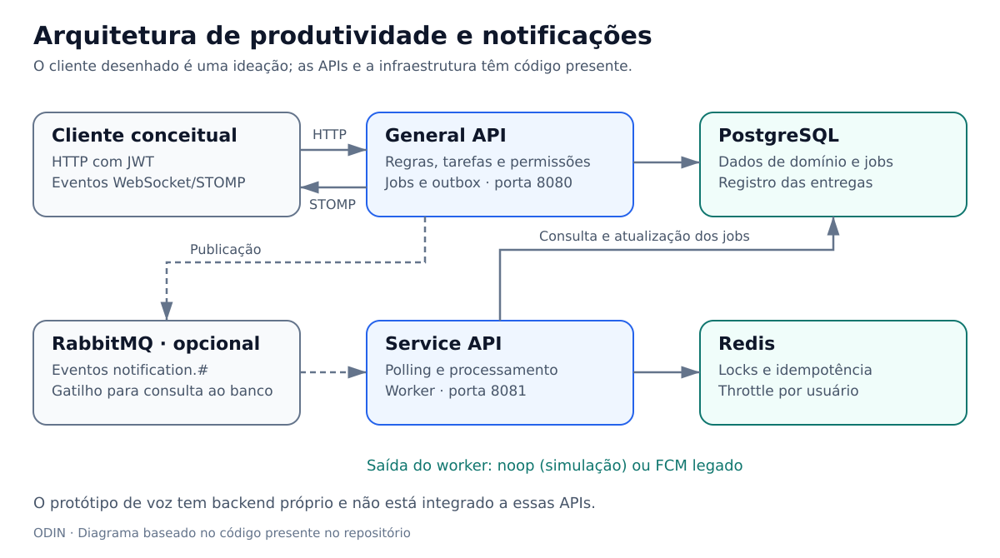
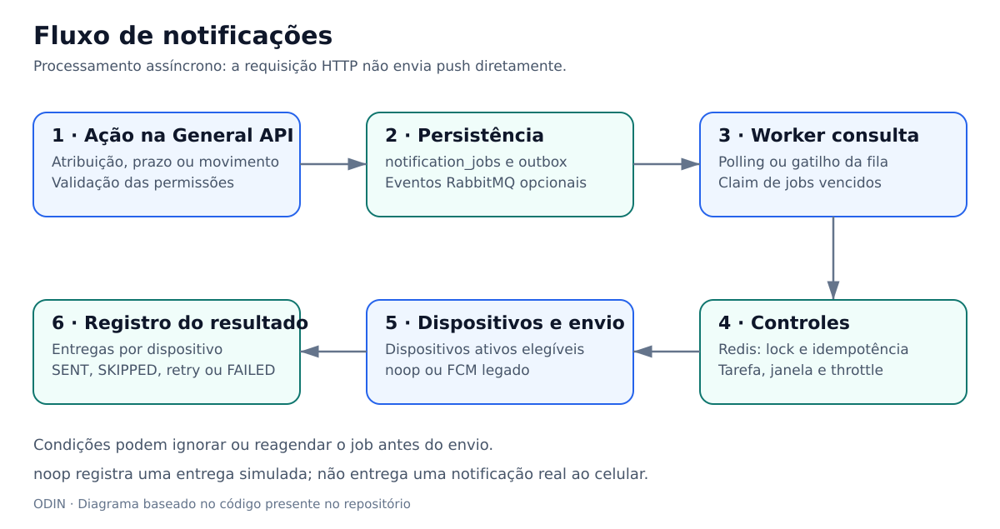
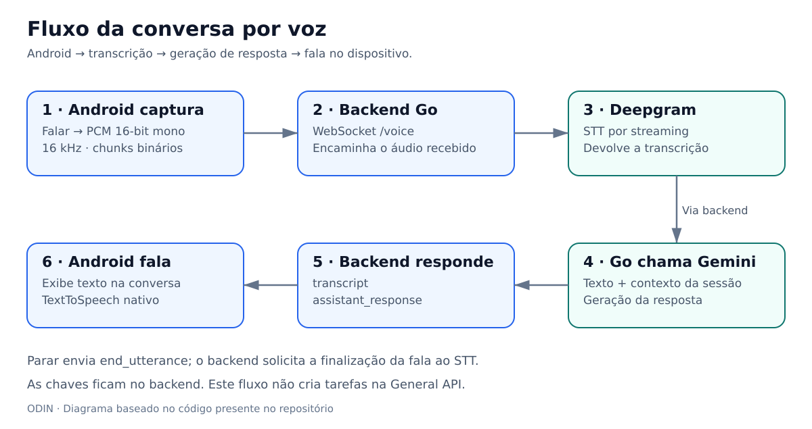

# Odin

**Backend de produtividade colaborativa e protótipo de assistente por voz para Android.**

O Odin reúne uma API principal para usuários, grupos, quadros kanban e tarefas; um serviço interno para processar notificações; e um experimento de conversa por voz com transcrição, geração de resposta e síntese de fala.

Este README descreve os projetos **presentes nesta pasta**, com base no código e na documentação local. As imagens de interface são **ideações com dados fictícios**, não capturas de uma aplicação pronta. Os diagramas representam os fluxos encontrados no código.



## Conteúdo

- [Projetos e estado atual](#projetos-e-estado-atual)
- [Arquitetura](#arquitetura)
- [Como funciona](#como-funciona)
- [Execução local](#execução-local)
- [Exemplos de uso](#exemplos-de-uso)
- [Verificação e limites](#verificação-e-limites)
- [Documentação](#documentação)

## Projetos e estado atual

| Projeto | Função | Tecnologias e estado |
| --- | --- | --- |
| [General API](backend/General%20API/README.md) | Autenticação, usuários, dispositivos, grupos, kanban, tarefas, regras e agendamento de notificações | Kotlin 2.4, Spring Boot 4.1, Java 21, PostgreSQL, Flyway, JWT e WebSocket/STOMP; código presente |
| [Service API](backend/Service%20API/README.md) | Worker de notificações e endpoints internos de operação | Go 1.26, chi, pgx, Redis e RabbitMQ opcional; código presente; provedor `noop` por padrão |
| [Voice AI Prototype](Odin%20conversational%20prototype/voice-ai-prototype/README.md) | Conversa por voz entre Android e um backend próprio | Kotlin, Jetpack Compose, AudioRecord, OkHttp, TextToSpeech, Go 1.22+, Deepgram e Gemini; protótipo separado |
| `Documents/` | Documentação e planejamento | Documentos HTML/DOCX, planos das APIs e guia de instalação |

```text
Odin/
├── README.md
├── docs/readme-images/              # Diagramas e ideações deste README
├── Documents/                      # Documentação e planos
├── backend/
│   ├── General API/                 # API pública Kotlin/Spring Boot
│   └── Service API/                 # Worker interno Go
└── Odin conversational prototype/
│   └── voice-ai-prototype/
│       ├── android-app/             # Aplicativo Android nativo
│       └── backend/                 # Backend Go da conversa por voz
```

## Arquitetura



A **General API** recebe requisições em `/api/v1`, autentica com JWT e aplica as permissões por grupo. O PostgreSQL guarda os dados de domínio, os jobs de notificação, as entregas e os eventos de outbox. O Flyway da General API cria o esquema usado também pelo worker.

A **Service API** consulta os jobs vencidos por polling. Quando `RABBITMQ_URL` está configurada, mensagens na fila também disparam a consulta ao banco: a fila funciona como gatilho, e os jobs persistidos continuam sendo a fonte de processamento. O Redis fornece locks, marcações de idempotência e controle de frequência de envio por usuário.

O **protótipo de voz** usa seu próprio backend e não depende desse banco ou dessas APIs. No código atual, uma conversa com Gemini não cria nem modifica tarefas do Odin.

## Como funciona

### Tarefas e colaboração

1. O usuário se cadastra ou faz login e recebe um token JWT.
2. Pode criar tarefas pessoais ou participar de grupos com quadros e colunas.
3. A General API valida permissões antes de criar, editar, mover ou concluir cards.
4. Movimentações são registradas, e eventos de quadros são publicados por WebSocket/STOMP.
5. Atribuições, prazos e movimentos podem gerar jobs de notificação. Concluir ou cancelar uma tarefa cancela seus jobs pendentes.

Os papéis de grupo são `ADMIN`, `EDITOR`, `MEMBER` e `VIEWER`. Administradores e editores podem editar cards; membros comuns podem mover os cards atribuídos a eles. As regras efetivas estão em [TaskPermissionValidator.kt](backend/General%20API/src/main/kotlin/br/com/odin/general/task/validator/TaskPermissionValidator.kt).

### Notificações em segundo plano



O worker faz claim dos jobs pendentes e vencidos no PostgreSQL, aplica lock e idempotência no Redis, verifica se a tarefa ainda é relevante, respeita a janela de horário e o throttle e busca dispositivos ativos. Depois registra uma entrega por dispositivo. Conforme o resultado, o job pode ser enviado, ignorado, reagendado ou encaminhado para retry/falha.

O provedor padrão **`noop` simula o envio e registra o resultado, sem entregar push real**. Existe também uma implementação FCM HTTP legado, selecionável por configuração. A General API não envia push diretamente durante a requisição de criação ou movimentação de uma tarefa.

### Conversa por voz



1. O usuário toca em **Conectar** e permite o acesso ao microfone.
2. Ao tocar em **Falar**, o Android captura áudio PCM de 16 bits, mono, a 16 kHz e envia chunks binários por WebSocket.
3. Ao tocar em **Parar**, o app envia `end_utterance`, e o backend finaliza a fala junto à Deepgram.
4. A transcrição retorna ao aplicativo e é enviada ao Gemini com contexto da sessão.
5. O backend devolve `assistant_response`; o app exibe a resposta e a lê com o TextToSpeech nativo do Android.

O contexto de conversa é mantido em memória e limitado às últimas oito mensagens. Não há login ou persistência de conversa em banco neste protótipo. As credenciais de Deepgram e Gemini são usadas pelo backend, não pelo Android.

## Execução local

Execute os comandos abaixo a partir da raiz do repositório, salvo quando indicada outra pasta. Cada servidor deve ficar em um terminal próprio.

### Pré-requisitos

| Componente | Requisitos declarados no projeto |
| --- | --- |
| General API | Java 21, Gradle instalado e Docker Compose para a infraestrutura local |
| Service API | Go 1.26; PostgreSQL e Redis disponíveis |
| Backend de voz | Go compatível com o módulo `go 1.22`; acesso às APIs de Deepgram e Gemini |
| Android | Android Studio, SDK 35, JDK compatível com o build Android (alvo Java 17) e dispositivo Android 8.0/API 26 ou superior |

### 1. Infraestrutura e General API

```bash
cd "backend/General API"
docker compose up -d

# Defina um segredo próprio para assinar os JWTs nesta sessão.
export JWT_SECRET="$(openssl rand -hex 32)"
gradle bootRun
```

O Compose inicia PostgreSQL em `5432`, Redis em `6379` e RabbitMQ em `5672`, com painel em `15672`. Os valores padrão do Compose são de desenvolvimento local. A General API lê variáveis de ambiente e as configurações de `application.yml`; copiar um arquivo `.env` não o carrega automaticamente.

| Recurso | Endereço padrão |
| --- | --- |
| Health da General API | `http://localhost:8080/api/v1/health` |
| Swagger UI | `http://localhost:8080/swagger-ui.html` |
| OpenAPI | `http://localhost:8080/v3/api-docs` |
| WebSocket/STOMP | `http://localhost:8080/ws` |

Principais variáveis: `SERVER_PORT`, `DATABASE_URL` (URL JDBC), `DATABASE_USERNAME`, `DATABASE_PASSWORD`, `JWT_SECRET`, `REDIS_HOST`, `REDIS_PORT` e `RABBITMQ_HOST`.

### 2. Worker de notificações

Depois que a General API tiver criado o esquema do banco, abra outro terminal:

```bash
cd "backend/Service API"
export SERVICE_TOKEN="$(openssl rand -hex 32)"
export NOTIFICATION_PROVIDER=noop
go run ./cmd/service-api
```

Os valores padrão conectam ao banco e ao Redis do Compose local. O serviço lê o ambiente do processo; não carrega `.env` automaticamente. Aqui `DATABASE_URL` usa o formato `postgres://`, diferente da URL JDBC da General API.

| Variável | Uso / padrão |
| --- | --- |
| `HTTP_ADDR` | Endereço HTTP; `:8081` |
| `SERVICE_TOKEN` | Credencial para endpoints internos de ação |
| `DATABASE_URL` | Conexão PostgreSQL compartilhada com a General API |
| `REDIS_ADDR` | `localhost:6379` |
| `WORKER_INTERVAL` / `WORKER_BATCH_SIZE` | Polling a cada `10s`, até `25` jobs por lote |
| `RABBITMQ_URL` | Consumidor opcional; desativado quando vazio |
| `NOTIFICATION_PROVIDER` | `noop` por padrão; `fcm` seleciona o provedor legado |
| `FCM_SERVER_KEY` | Credencial do provedor FCM legado, quando usado |
| `THROTTLE_WINDOW` / `IDEMPOTENCY_TTL` | `15m` / `24h` |

Health: `http://localhost:8081/internal/v1/health`. Readiness, com verificação de PostgreSQL e Redis: `http://localhost:8081/internal/v1/ready`.

Para processar os jobs vencidos manualmente, no terminal onde `SERVICE_TOKEN` foi definido:

```bash
curl -X POST http://localhost:8081/internal/v1/notification-jobs/process \
  -H "X-Service-Token: $SERVICE_TOKEN"
```

Também existe `POST /internal/v1/notification-jobs/{jobId}/retry`. Os endpoints de ação aceitam `X-Service-Token` ou `Authorization: Bearer`; health e readiness não usam esse middleware.

### 3. Backend de voz

```bash
cd "Odin conversational prototype/voice-ai-prototype/backend"
go mod download

# Leia as chaves sem colocá-las no histórico de comandos.
read -rsp "Chave Gemini: " GEMINI_API_KEY; printf '\n'
export GEMINI_API_KEY
read -rsp "Chave Deepgram: " DEEPGRAM_API_KEY; printf '\n'
export DEEPGRAM_API_KEY

go run ./cmd/server
```

O loader atual exige um `.env.example` acessível e o lê como configuração de fallback. Variáveis já exportadas têm prioridade. Ele **não carrega `.env`**: mantenha chaves reais no ambiente, não no arquivo de exemplo versionado.

As variáveis incluem `PORT`, `WS_PATH`, `GEMINI_MODEL`, `GEMINI_MAX_OUTPUT_TOKENS`, `DEEPGRAM_MODEL`, `DEEPGRAM_LANGUAGE` e `DEEPGRAM_SAMPLE_RATE`. Os padrões declarados são porta `8080`, caminho `/voice`, idioma `pt-BR` e amostragem de `16000` Hz. A disponibilidade dos modelos configurados depende do provedor.

**A General API e o backend de voz usam `8080` por padrão.** Para executar ambos juntos, defina `PORT=8082` no terminal do backend de voz e ajuste a URL no Android para a mesma porta.

### 4. Aplicativo Android

Abra `Odin conversational prototype/voice-ai-prototype/android-app` no Android Studio, sincronize o Gradle e execute no dispositivo. O projeto atual inclui Gradle Wrapper; para gerar o APK debug:

```bash
cd "Odin conversational prototype/voice-ai-prototype/android-app"
./gradlew :app:assembleDebug
adb install -r app/build/outputs/apk/debug/app-debug.apk
```

A URL está em [AppConfig.kt](Odin%20conversational%20prototype/voice-ai-prototype/android-app/app/src/main/java/com/example/voiceai/AppConfig.kt). O valor ativo é `ws://127.0.0.1:8080/voice`, pensado para dispositivo conectado por USB com redirecionamento:

```bash
adb reverse tcp:8080 tcp:8080
```

| Forma de conexão | URL a configurar no app |
| --- | --- |
| USB com `adb reverse` | `ws://127.0.0.1:8080/voice` |
| Emulador Android | `ws://10.0.2.2:8080/voice` |
| Dispositivo na mesma rede | `ws://IP_DO_COMPUTADOR:8080/voice` |

Se usar `8082`, ajuste tanto a URL quanto o comando `adb reverse`. Depois de instalar, permita o microfone e siga **Conectar → Falar → Parar**.

## Exemplos de uso

### Organização de uma tarefa pessoal

Exemplo de requisição, usando um JWT obtido no login e armazenado na variável `ODIN_ACCESS_TOKEN`:

```bash
curl -X POST http://localhost:8080/api/v1/tasks/personal \
  -H "Authorization: Bearer $ODIN_ACCESS_TOKEN" \
  -H "Content-Type: application/json" \
  -d '{"title":"Planejar a semana","description":"Separar prioridades e blocos de trabalho","priority":"MEDIUM"}'
```

A resposta contém o identificador da tarefa, título, prioridade, status e criador. Esse exemplo não define um prazo; para agendar um lembrete de vencimento, informe também `dueAt` no formato de instante ISO 8601. A configuração padrão agenda esse lembrete 30 minutos antes do prazo.

### Quadro colaborativo e lembrete

A ideação de kanban no início deste README mostra uma possível interface para os recursos do backend. Um administrador cria um grupo e um quadro, atribui um card a um membro e acompanha seu movimento de coluna. A atribuição gera um job; quando ele está vencido e há um dispositivo ativo elegível, o worker processa o envio. Em `noop`, a entrega é simulada.

Essa interface é uma proposta visual de cliente, não um frontend presente nesta pasta.

### Pergunta por voz

Na ideação Android, o usuário pergunta **“Como organizar minha semana?”**. O áudio é transcrito, Gemini gera uma resposta e o Android a fala. O texto ilustrado **“Defina prioridades e reserve blocos de tempo.”** é fictício; a resposta real depende do modelo e do contexto. Esse fluxo é uma conversa e não executa a requisição de criação de tarefa mostrada acima.

## Verificação e limites

Para executar os testes já existentes, entre na pasta de cada projeto:

```bash
# backend/General API
gradle test

# backend/Service API
go test ./...
```

Há um teste simples de identidade do projeto Kotlin e testes auxiliares do worker; essa cobertura não comprova os fluxos completos de integração. Os diagramas documentam a implementação, sem prometer entrega exatamente uma vez ou recuperação automática em todos os cenários. O tratamento de retries e idempotência deve ser validado para o ambiente de uso.

O backend de voz grava áudio WAV de diagnóstico ao finalizar falas e mantém contexto em memória. `ODIN_AUDIO_DEBUG_DIR` permite escolher a pasta; no código atual, deixá-la vazia ativa um caminho padrão, em vez de desabilitar a gravação. Considere esse comportamento ao usar dados reais.

O guia antigo em `Documents/guia-iniciar-backend-modelos-e-build-android.md` ainda descreve um backend Node.js e ausência de Gradle Wrapper. Para a estrutura atual, use os comandos Go e Wrapper deste README. O FCM presente é legado; o modo local demonstrado usa `noop`.

## Documentação

| Documento | Conteúdo |
| --- | --- |
| [README da General API](backend/General%20API/README.md) | Responsabilidades e endpoints públicos |
| [Documentação HTML da General API](Documents/odin-general-api-documentation.html) | Módulos, rotas e fluxo de notificações |
| [Plano da General API](Documents/planning/general-api-plan.md) | Arquitetura proposta e critérios de aceite |
| [README da Service API](backend/Service%20API/README.md) | Worker e endpoints internos |
| [Documentação HTML da Service API](Documents/odin-service-api-documentation.html) | Processamento, componentes e configuração |
| [Plano da Service API](Documents/planning/service-api-plan.md) | Responsabilidades e requisitos do worker |
| [README do protótipo de voz](Odin%20conversational%20prototype/voice-ai-prototype/README.md) | Protocolo WebSocket, STT, LLM e Android |
| [Guia de instalação anterior](Documents/guia-iniciar-backend-modelos-e-build-android.md) | Referência histórica; contém instruções superadas |
| [Fontes e prompts das imagens](docs/readme-images/README.md) | Origem, significado e geração das ilustrações |

As versões DOCX das documentações das APIs também estão em `Documents/`. Em caso de divergência entre planejamento e comportamento, consulte as configurações, controllers e serviços do código atual.
